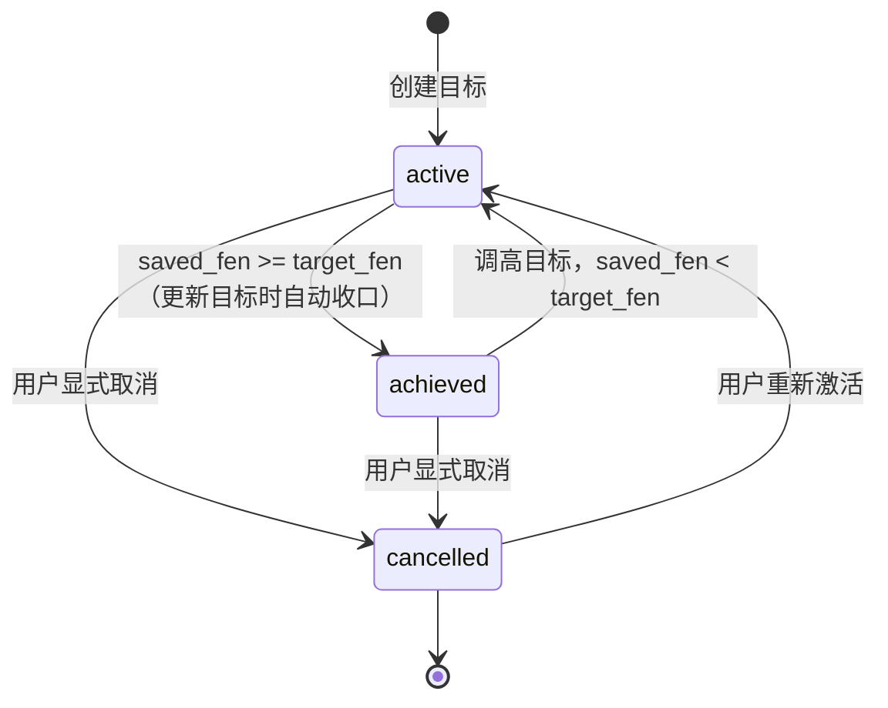
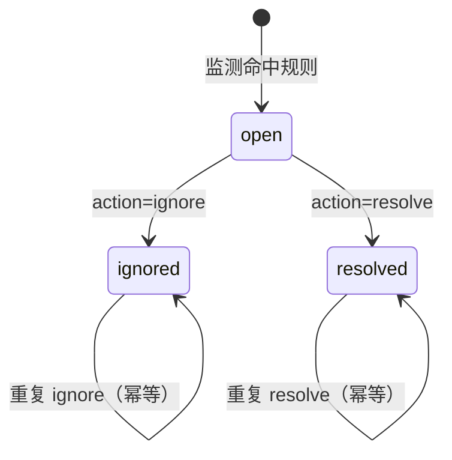
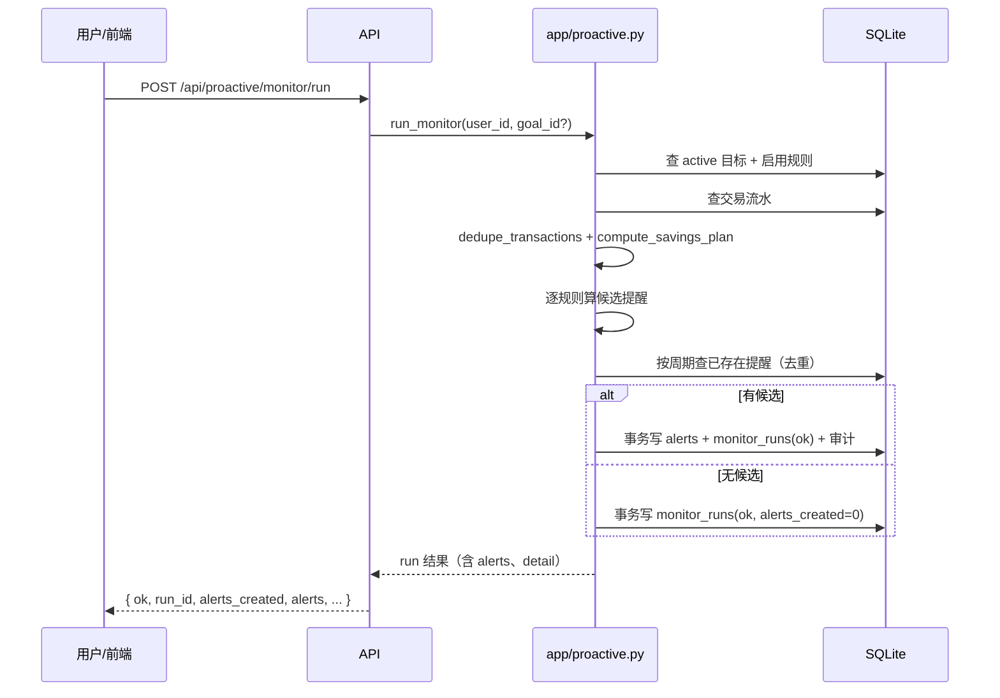

# 12 主动财务管理设计

> 对应阶段：阶段 5「主动财务管理闭环」。
> 对应代码：`app/proactive.py`（确定性计算与仓储）、`app/tools/proactive.py`（7 个工具）、
> `app/db.py`（4 张新表）、`app/api/routes.py` 与 `app/api/schemas.py`（7 个端点）、
> `web/index.html` 的「主动财务（模拟数据）」面板。
> 对应测试：`tests/test_proactive_calc.py`、`tests/test_proactive_api.py`、`tests/test_proactive_safety.py`。
> 本文只描述已经实现的代码，不描述尚未实现的定时器、后台服务或真实支付能力。

## 12.1 目标与边界

### 12.1.1 用户故事

> 「我希望在 2026-12-31 前存够 3 万元，每个月帮我关注一下进度。」

系统要做的是一条可解释、可复核的闭环：

1. 用户创建储蓄目标（目标金额、目标日期、当前已存）；
2. 后端读取该用户的历史交易流水；
3. 用确定性公式算出剩余金额、剩余周期、每期需存、历史平均收入、必要支出、预计结余、可行性；
4. 按目标生成监测规则（进度、预算）；
5. 用户手动触发一次监测；
6. 监测按规则判断偏差，生成带证据的提醒；
7. 用户忽略/解决提醒，或调整目标；
8. 调整后重新计算，回到第 3 步。

### 12.1.2 能力边界：只做分析、计划、提醒

这套主动财务能力的权限被刻意限制在三件事：

| 允许 | 具体表现 |
| --- | --- |
| 分析 | 读 `transactions`、`accounts`、`savings_goals`，做收入/支出/预算统计 |
| 计划 | 输出结构化数字与假设说明，不替用户做决定 |
| 提醒 | 写 `proactive_alerts` 与 `monitor_runs`，提示用户处理 |

**不做的事（硬边界）**：

- 不自动转账、不申购理财、不修改任何账户余额；
- 不自动从某个账户「扣一笔钱存起来」；
- 不替用户确认任何交易；
- 不把提醒直接变成一笔资金操作。

在代码层面，这条边界由三处共同保证：

1. 7 个工具中没有任何一个进入 `SPEND_TOOLS`、`SENSITIVE_TOOLS` 或 `INVEST_TOOLS`；
2. `app/proactive.py` 的 `run_monitor` 只写 `proactive_alerts` 与 `monitor_runs`，不写 `accounts` / `transactions`；
3. 测试 `tests/test_proactive_safety.py` 对账户余额、交易条数做前后快照，任何路径变化都会失败。

### 12.1.3 手动触发，不是 7×24 后台服务

本阶段**只有手动触发**：前端按钮「立即运行监测（手动触发）」或
`POST /api/proactive/monitor/run`。每次调用产生一条 `monitor_runs` 记录。

明确不包含：

- 没有常驻进程、没有定时任务、没有后台调度器；
- 不会在用户不操作时自己跑；
- 不会因为「到了月初」自动提醒。

后续如果接入定时器，也只应复用同一个 `run_monitor`，不应另写一套判断逻辑；
定时器接入不属于本阶段的交付内容。

### 12.1.4 模拟数据声明

演示库中的用户、账户、流水都是竞赛模拟数据，不对应任何真实银行账户。
其中 `POST /api/proactive/simulate/expense` 是**竞赛演示专用**的注入端点：

- 它插入一条 `channel='simulated'` 的支出流水，并同步演示账户余额，目的是让评委
  现场看到「新增支出 → 重跑监测 → 出现预算提醒」；
- 它由用户显式调用，不是主动服务自动执行的；
- 它不接任何真实支付渠道，不产生转账/申购/扣款语义；
- 响应固定带 `simulated: true` 与一句 `notice`：「这是竞赛演示用的模拟流水，
  不对应任何真实支付。」

除这个显式演示端点外，主动财务的所有路径都不写 `accounts` / `transactions`。

### 12.1.5 非目标

- 不做多用户切换（当前库是单用户演示库）；
- 不做跨币种（固定 `CNY`）；
- 不预测投资收益，不把理财收益算进结余；
- 不判断某笔消费「该不该花」，只做预算偏差与进度偏差；
- 不替代真实的银行核心系统。

## 12.2 数据模型

### 12.2.1 为什么在改造前 18 张表的基础上扩展

阶段 5 新增 4 张表（`app/db.py` 中 `TABLE_NAMES` 从 18 张变为 22 张），
但不新建用户、账户、流水表，原因如下：

- **主体不能伪造**：储蓄目标必须挂在 `users.id` 上，账户与流水必须来自既有的
  `accounts` / `transactions`，否则「谁的目标、基于哪份流水」无法追溯；
- **安全层已经覆盖**：既有表已有外键、只读工具、审计与三色裁决；新建平行表会绕开
  这些既有约束；
- **只加计划与提醒**：四张新表只存「计划、规则、提醒、运行记录」，不复制余额，
  不成为第二套账；
- **迁移成本最低**：沿用 `SCHEMA_SQL` + `ensure_columns` 的建表方式，不引入迁移框架。

种子数据与 `scripts/seed.py` 的 `tables_all_present` 检查会随 `TABLE_NAMES` 自动覆盖
新表，无需另写建表脚本。

### 12.2.2 四张表

#### savings_goals（储蓄目标）

| 字段 | 类型/约束 | 说明 |
| --- | --- | --- |
| `id` | TEXT PRIMARY KEY，前缀 `sg_` | 目标 ID，由 `app/ids.py` 生成 |
| `user_id` | TEXT NOT NULL，REFERENCES `users(id)` | 目标所属用户 |
| `name` | TEXT NOT NULL DEFAULT '' | 目标名称，默认「储蓄目标」 |
| `target_fen` | INTEGER NOT NULL，CHECK > 0 | 目标金额，整数分，上限 `MAX_TARGET_FEN` |
| `target_date` | TEXT NOT NULL | 本地日历日 `YYYY-MM-DD`，不是 UTC 时间戳 |
| `saved_fen` | INTEGER NOT NULL DEFAULT 0，CHECK >= 0 | 当前已存，整数分，不允许超过目标 |
| `status` | TEXT CHECK IN ('active','achieved','cancelled') | 目标状态 |
| `created_ms` | INTEGER NOT NULL | 创建时刻，毫秒 |
| `updated_ms` | INTEGER NOT NULL | 最近更新时刻，毫秒 |

索引：`idx_savings_goals_user(user_id, status)`。

口径说明：`saved_fen` 是**用户登记/调整的累计储蓄**，不是从流水自动推断的余额。
本阶段无法可靠区分「消费」与「储蓄转账」，因此不自动累加；这一点在 12.11 节明确列为限制。

#### monitor_rules（监测规则）

| 字段 | 类型/约束 | 说明 |
| --- | --- | --- |
| `id` | TEXT PRIMARY KEY，前缀 `mr_` | 规则 ID |
| `goal_id` | TEXT NOT NULL，REFERENCES `savings_goals(id)` | 所属目标 |
| `kind` | TEXT CHECK IN ('progress','budget') | 进度规则 / 预算规则 |
| `threshold` | INTEGER NOT NULL，CHECK > 0 | 进度规则=允许落后百分点；预算规则=本期支出上限（分） |
| `period` | TEXT CHECK IN ('monthly','weekly') | 规则周期 |
| `enabled` | INTEGER NOT NULL DEFAULT 1，CHECK IN (0,1) | 是否启用 |
| `created_ms` | INTEGER NOT NULL | 创建时刻 |

索引：`idx_monitor_rules_goal(goal_id, enabled)`。

创建目标时**必建**一条 `progress` 规则（默认容差 10 个百分点）；
只有请求里给了 `budget_fen` 才建 `budget` 规则。规则的 `threshold` 同时承载两种语义，
因此字段类型统一为整数，语义由 `kind` 决定，不能混用。

#### proactive_alerts（主动提醒）

| 字段 | 类型/约束 | 说明 |
| --- | --- | --- |
| `id` | TEXT PRIMARY KEY，前缀 `pa_` | 提醒 ID |
| `goal_id` | TEXT NOT NULL，REFERENCES `savings_goals(id)` | 所属目标 |
| `rule_id` | TEXT，REFERENCES `monitor_rules(id)`，可为 NULL | 目标级现金流提醒没有规则 |
| `reason` | TEXT NOT NULL | `progress_behind` / `budget_overspent` / `cashflow_insufficient` |
| `evidence_json` | TEXT NOT NULL | 结构化证据（JSON），金额全部为整数分 |
| `suggestion` | TEXT NOT NULL DEFAULT '' | 确定性模板生成的中文建议，不由模型算金额 |
| `created_ms` | INTEGER NOT NULL | 创建时刻 |
| `status` | TEXT CHECK IN ('open','ignored','resolved') | 提醒状态 |
| `resolved_ms` | INTEGER，可为 NULL | 处理时刻 |

索引：`idx_alerts_goal_status(goal_id, status, created_ms)`、`idx_alerts_created(created_ms)`。

`evidence_json` 是「有证据的提醒」的核心：每条提醒都能回答「哪个周期、哪个规则、
期望多少、实际多少、差多少、按哪份流水算的」。完整字段见 12.5 节与 12.7 节。

#### monitor_runs（监测运行记录）

| 字段 | 类型/约束 | 说明 |
| --- | --- | --- |
| `id` | TEXT PRIMARY KEY，前缀 `mnr_` | 运行 ID |
| `started_ms` | INTEGER NOT NULL | 开始时刻 |
| `finished_ms` | INTEGER NOT NULL | 结束时刻 |
| `status` | TEXT CHECK IN ('ok','failed') | 运行结果 |
| `alerts_created` | INTEGER NOT NULL DEFAULT 0 | 本轮新建提醒数 |
| `detail` | TEXT NOT NULL DEFAULT '' | 摘要；成功为 `goals=N;rules=M;expired_skipped=K`，失败为异常类型与消息（截断 300 字符） |

索引：`idx_monitor_runs_started(started_ms)`。

### 12.2.3 状态机

目标状态：



说明：创建时一律为 `active`；创建时 `saved_fen` 不允许超过 `target_fen`。
「自动收口」只发生在 `PATCH /api/savings/goals/{id}`（`update_goal`）时，
监测本身不修改目标状态。

提醒状态：



提醒一旦离开 `open` 就不会被监测重新打开；同一周期内即使再次命中，
去重逻辑也会因为「存在同周期提醒」而跳过（见 12.5.3）。
下一个周期才会生成新提醒。

运行状态：`ok`（提醒与运行记录同一事务提交）或 `failed`（提醒回滚，另写失败记录）。

### 12.2.4 ID 与索引

- ID 统一由 `app/ids.py:new_id` 生成，格式为「前缀 + 下划线 + 8 位十六进制」；
  阶段 5 在 `ID_PREFIXES` 白名单中新增 `sg` / `mr` / `pa` / `mnr`；
- 所有外键都指向既有 `users` / `accounts` / `transactions` 或本组新表，
  不引入跨库引用；
- 索引按真实查询路径设计：按用户查目标、按目标查启用规则、按目标+状态查提醒、
  按时间查运行记录。

### 12.2.5 不变量

1. `target_fen > 0`、`saved_fen >= 0`、`saved_fen <= target_fen`；
2. 只有 `active` 目标参与监测；`achieved` 与 `cancelled` 不产生新提醒；
3. 每条 `budget` / `progress` 提醒都关联一条真实存在的规则；目标级现金流提醒
   `rule_id` 为 NULL 是有意设计；
4. 提醒金额证据全部为整数分，展示用元时单独给 `*_yuan` 字符串；
5. `monitor_runs` 与提醒在同一事务里提交，不会出现「有提醒没运行记录」的成功态。

## 12.3 确定性计算

### 12.3.1 三条铁律

1. **模型不算钱**。模型只做意图解析、参数抽取与自然语言解释；所有金额、周期、
   可行性、预算偏差都由 `app/proactive.py` 的纯函数计算，提醒里的 `suggestion`
   也是确定性模板字符串，不经过模型。
2. **只用整数分**。所有金额以 `int` 分存储与计算，元只用于展示
   （`fen_to_yuan_str`）。代码中不出现 `float` 参与算钱。
3. **币种固定 CNY，目标日期是本地日历日**。`target_date` 存 `YYYY-MM-DD`，
   用 `local_date()` 取本地「今天」，避免 UTC 推日把目标日期算错一天。

### 12.3.2 公式清单

| 指标 | 函数/字段 | 公式与口径 |
| --- | --- | --- |
| 当前累计储蓄 | `saved_fen` | 目标上登记的已存金额（整数分） |
| 剩余目标 | `remaining_fen` | `max(0, target_fen - saved_fen)` |
| 剩余天数 | `days_remaining` | `target_date - today` 的自然日差；可为负 |
| 剩余计划周期数 | `periods_remaining` | 按自然月、**包含当月**；目标日期已过为 0 |
| 阶段储蓄要求 | `required_per_period_fen` | `ceil(remaining_fen / periods_remaining)`；周期为 0 时直接返回剩余金额 |
| 历史平均收入 | `avg_income_fen` | 最近 N 个完整月的收入合计 ÷ 有交易的月份数，四舍五入到分 |
| 必要支出 | `avg_essential_fen` | 同上，只统计 `ESSENTIAL_CATEGORIES` 的支出 |
| 预计周期结余 | `projected_period_balance_fen` | `avg_income_fen - avg_essential_fen` |
| 可行性 | `feasibility` | 依次判断：已达成 → 日期已过 → 无历史 → 结余不为正 / 要求超过结余 → 可行 |
| 预算偏差 | `budget_deviation` | `deviation_fen = actual_fen - budget_fen`，并给出超支/剩余/使用率 |
| 阶段缺口 | `period_gap_fen` | `max(0, required_per_period_fen - projected_period_balance_fen)` |
| 阶段盈余 | `period_surplus_fen` | `max(0, projected_period_balance_fen - required_per_period_fen)` |
| 总缺口 | `total_gap_fen` | `period_gap_fen * periods_remaining`，仅在确有缺口时为非零 |

#### 剩余周期为什么「包含当月」

从 2026-10-23 到 2026-12-31，还有 10 月、11 月、12 月三个可行动的自然月，
因此 `periods_remaining = 3`。如果目标就在本月（例如 10-31），则为 1；
如果目标日期已过，返回 0。0 的含义是「没有下一期了」，不是「不需要存」：
此时阶段要求退化为「剩余金额需要一次性补齐」。

#### 阶段要求为什么向上取整

`required_per_period = (remaining_fen + periods - 1) // periods`。
2,500,000 分 ÷ 3 = 833,333.33…，输出 833,334 分。向下取整会放过一分钱缺口，
与「每期至少存够」的语义冲突；向上取整到分是唯一不自欺的选择。

#### 历史基准的窗口与分母

- 窗口是最近 `N` 个**完整自然月**（默认 6，允许 1–24），**不含当月**：
  当月还没走完，半个月的数据会把平均值压低；
- 分母不是 `N`，而是窗口内「有交易的月份数」。例如窗口 6 个月但只有 3 个月有流水，
  就按 3 个月平均，避免把空月份当 0 收入；
- 先做 `dedupe_transactions`，再排除 `转账` / `理财` 两个内部搬运分类；
- 收入=方向 `in` 且金额 > 0；支出=方向 `out` 且金额 > 0；
- 必要支出只统计分类在 `ESSENTIAL_CATEGORIES = (餐饮, 交通, 生活缴费, 医疗, 订阅)`
  内的支出；购物、娱乐等可选消费不计入，所以「预计结余」天然偏乐观。

#### 四舍五入也是整数运算

所有平均数使用 `_div_round(total, count) = (total + count // 2) // count`，
只使用整数加减乘除；百分比使用整数除法向下取整（如进度 16%、使用率 130%），
不使用 `round()` 或浮点。

#### 可行性判定顺序

```text
saved >= target                         -> ACHIEVED    （warning: GOAL_ACHIEVED）
否则 target_date < today                -> EXPIRED     （warning: TARGET_DATE_PASSED）
否则 无交易历史                          -> UNKNOWN     （warning: NO_TRANSACTION_HISTORY）
否则 projected_balance <= 0             -> INFEASIBLE  （warning: CASHFLOW_NOT_POSITIVE）
否则 required_per_period > projected    -> INFEASIBLE  （warning: REQUIRED_EXCEEDS_SURPLUS）
否则                                     -> FEASIBLE
```

`UNKNOWN` 是冷启动的正式答案：没有历史数据时不编造一个「可行/不可行」的结论，
只给出目标与日期，并明确告知「缺历史基准」。前端应把它显示为「数据不足」，
而不是绿色通过。

#### 缺口与盈余互斥

`period_gap_fen` 与 `period_surplus_fen` 至少有一个为 0：

- 阶段要求高于预计结余 → 有缺口，盈余为 0；
- 阶段要求低于预计结余 → 有盈余，缺口为 0；
- 已达成/无剩余 → 两者都为 0。

`total_gap_fen` 只累计「每期缺口 × 剩余周期」，不是把历史所有缺口相加。
它回答的是「按当前收支，到目标日大约还差多少」，用于排序与解释，不是会计余额。

#### 预算偏差

```text
deviation_fen = actual_fen - budget_fen        # 正数=超支，负数=还有余量
over_budget   = deviation_fen > 0
over_fen      = max(0, deviation_fen)
remaining_fen = max(0, budget_fen - actual_fen)
usage_pct     = actual_fen * 100 // budget_fen  # 整数，向下取整
```

预算规则的 `threshold` 就是 `budget_fen`；实际支出按规则周期
（`monthly` 从当月 1 日，`weekly` 从周一）重新汇总，先去掉冲正与重复流水，
再排除 `转账` / `理财`。

### 12.3.3 计算示例

基准日 2026-10-23，目标 3,000,000 分（30,000 元），目标日 2026-12-31，
已存 500,000 分（5,000 元）；最近 6 个完整月中有 6 个月有流水，
平均收入 1,280,000 分，平均必要支出 400,000 分：

| 指标 | 结果 |
| --- | --- |
| 剩余周期 | 3（10、11、12 月） |
| 剩余目标 | 2,500,000 分（25,000 元） |
| 阶段要求 | 833,334 分（8,333.34 元） |
| 当前进度 | 16%（500,000 × 100 ÷ 3,000,000，向下取整） |
| 预计周期结余 | 880,000 分（8,800 元） |
| 可行性 | FEASIBLE |
| 阶段缺口 | 0 |
| 阶段盈余 | 46,666 分（466.66 元） |
| 总缺口 | 0 |

如果把目标调高到 12,000,000 分（120,000 元）、已存仍为 0，在同样的收支下：

- 剩余 12,000,000 分，阶段要求 4,000,000 分，预计结余 880,000 分；
- 阶段缺口 3,120,000 分，总缺口 9,360,000 分；可行性 `INFEASIBLE`，
  warning 为 `REQUIRED_EXCEEDS_SURPLUS`。这组数字与
  `tests/test_proactive_calc.py` 的断言一致。

## 12.4 边界处理

| 边界 | 处理 | 用户可见结果 |
| --- | --- | --- |
| `target_fen <= 0` | 创建/更新时抛 `ValidationError`（400） | 明确告知金额必须大于 0 |
| `target_fen > MAX_TARGET_FEN` | 400 | 超出单目标上限 |
| `target_date` 格式错误 | 严格解析 10 位 `YYYY-MM-DD`，失败 400 | 不接受「2026/12/31」等模糊格式 |
| 目标日期已过 | `feasibility=EXPIRED`，`periods_remaining=0`，阶段要求=剩余金额；监测跳过该目标并计入 `expired_skipped` | 不制造「每月都落后」的焦虑提醒，提示调整日期 |
| 剩余周期为 0 | `required_per_period` 直接返回剩余金额；不做除零 | 缺口退化为一次性补齐 |
| 无任何历史交易 | `feasibility=UNKNOWN`，warning `NO_TRANSACTION_HISTORY`；不产生进度/现金流提醒（预算规则仍可独立判断） | 显示「数据不足」，而不是伪造可行/不可行 |
| 历史收入或支出为负 | 金额 `<= 0` 的流水跳过，不参与汇总（DB 的 CHECK 本来就禁止，防御历史脏数据） | 负数不会把平均值拉低或抵消支出 |
| 退款/冲正 | 有 `reversed_by` 的原交易、有 `reversal_of` 的冲正行都不计入 | 退款对不会被重复计为收入或支出 |
| 重复流水 | 同账户/方向/金额/对方/时刻/分类完全相同的行只保留第一笔 | 重复导入不会放大收入或支出 |
| 部分月份 | 当月与窗口外的月份不计入历史基准；预算监测则按当前周期实时汇总 | 历史基准不被半个月压低；预算提醒仍然及时 |
| `saved_fen > target_fen` | 创建/更新时 400 | 不允许「已存超过目标」的脏状态 |
| 已达成目标 | `feasibility=ACHIEVED`，监测不产提醒 | 显示已完成，不再催 |
| 金额精度 | 全部整数分；平均数整数四舍五入；比率向下取整；元展示单独格式化 | 不出现 0.1+0.2 类误差 |
| 币种 | 只接受 `CNY`，其他币种 400 | 不静默换算 |
| 无用户数据 | `default_user_id` 抛 400（`NO_USERS`） | 明确「还没有用户数据」，不猜主体 |
| 无账户（仅模拟注入端点） | 400（`NO_ACCOUNTS`） | 演示注入失败，不写半条流水 |
| 重复处理提醒 | 已 `ignored`/`resolved` 的提醒再次处理返回同一提醒，`idempotent=true`，不重复审计 | 幂等，不报错也不重复写 |
| 监测异常 | 回滚本轮全部提醒，写一条 `status='failed'` 的运行记录与审计 | 明确失败，不假装成功 |

## 12.5 监测闭环

### 12.5.1 一次手动监测的步骤

```text
POST /api/proactive/monitor/run
  -> 读 active 目标（可按 goal_id 过滤）
  -> 目标日期已过？ 是：计入 expired_skipped，跳过
  -> 读该目标的启用规则
  -> 读该用户交易流水，先去重
  -> 逐规则计算候选提醒（不写库）
  -> 按周期去重（同目标+同规则+同原因+同周期起点）
  -> 单事务：写 proactive_alerts + 写 monitor_runs(ok) + 写审计
  -> 返回本轮 run 与提醒列表
```

### 12.5.2 时序（文字版 mermaid）



### 12.5.3 三类提醒与证据

| 类型 | 触发条件 | `reason` | `evidence_json` 关键字段 |
| --- | --- | --- | --- |
| 进度落后 | `期望进度 - 实际进度 > 容差`，且仍有剩余、日期未过 | `progress_behind` | `expected_pct`、`actual_pct`、`lag_pp`、`threshold_pp`、`expected_saved_fen`、`saved_fen`、`target_fen`、`remaining_fen`、`periods_remaining`、`required_per_period_fen`、`avg_income_fen`、`avg_essential_fen`、`projected_period_balance_fen`、`feasibility`、`evaluated_ms` |
| 预算超支 | 当前周期实际支出 > 预算阈值 | `budget_overspent` | `budget_fen`、`actual_fen`、`deviation_fen`、`over_fen`、`usage_pct`、`period_label`、`evaluated_ms` |
| 现金流不足（目标级） | 仍有剩余、日期未过、`feasibility=INFEASIBLE`、有历史 | `cashflow_insufficient` | `avg_income_fen`、`avg_essential_fen`、`projected_period_balance_fen`、`required_per_period_fen`、`period_gap_fen`、`remaining_fen`、`feasibility`、`evaluated_ms` |

进度期望值使用「目标创建日 → 目标日」的时间轴：

```text
total_days    = max(1, target_date - created_date)
elapsed_days  = clamp(today - created_date, 0, total_days)
expected_saved = target_fen * elapsed_days // total_days
expected_pct   = min(100, expected_saved * 100 // target_fen)
lag_pp         = expected_pct - actual_progress_pct
```

这样可以避免「刚建目标就要求存到 50%」；如果用户创建目标时已经存了一部分，
进度从建目标那天开始衡量，已存金额直接进入进度。

### 12.5.4 按周期去重

去重键是「目标 + 规则（或目标级 NULL）+ 原因 + 周期起点」：

- 进度/预算规则按自己的 `period` 取周期起点：`monthly` 为当月 1 日，
  `weekly` 为本周周一；
- 目标级现金流提醒固定按当月 1 日；
- 查询 `proactive_alerts` 时**不看提醒状态**：已忽略的提醒同样阻止本周期重复生成。
  这是有意设计——用户已经说「先放着」，同周期不应再弹一次；
- 下一个周期起点之后才会生成新提醒。

去重查询与候选计算在写事务之前完成；在并发手动触发下，两个请求理论上都可能通过
去重检查。当前是单用户演示库、手动触发，未加唯一约束；这是 12.11 节列出的已知风险。

### 12.5.5 提醒处理与重算

- `POST /api/proactive/alerts/{id}/resolve`：`action=ignore` → `ignored`，
  `action=resolve` → `resolved`，写 `resolved_ms` 与审计；
- 重复处理返回原提醒，`idempotent=true`，`audit_seq=null`；
- 用户 `PATCH /api/savings/goals/{id}` 调金额/日期/已存/预算/容差后，
  响应里的 `goal` 已包含新计划（`plan` 与 `budget`），前端无需自己算；
- 监测本身不修改 `saved_fen`：它只观测，不代替用户记账。

### 12.5.6 失败语义

- 候选计算或写库抛异常：事务回滚，**本轮不留下任何半截提醒**；
- 另开事务写一条 `monitor_runs(status='failed', alerts_created=0, detail=异常类型:消息)`
  并写 `proactive.monitor_run` 审计（`status=failed`）；
- API 返回 `ok=false, status='failed', alerts=[]`，不假装成功；
- 指定 `goal_id` 但目标不存在：直接返回 `status='failed', detail='GOAL_NOT_FOUND'`。
  这条路径**不写** `monitor_runs`（见 12.11 限制）。

## 12.6 工具与权限登记

### 12.6.1 七个工具

登记位置：`app/tools/proactive.py`（处理器）、`app/tools/tool_specs.py`（参数 schema）、
`app/policy/rules.py`（三色分类）。

| 工具 | 分类 | 主要参数 | 是否写库 |
| --- | --- | --- | --- |
| `list_savings_goals` | 只读（READONLY_TOOLS） | `status`（active/achieved/cancelled/all）、`limit` | 否 |
| `compute_savings_plan` | 只读 | `goal_id` 或 `target_fen`+`target_date`、`saved_fen`、`lookback_months` | 否 |
| `create_savings_goal` | 黄灯（CONFIRM_ONLY_TOOLS） | `name`、`target_fen`、`target_date`；可选 `saved_fen`、`budget_fen`、`progress_tolerance`、`period` | 写目标+规则+审计 |
| `update_savings_goal` | 黄灯 | `goal_id`；可选金额/日期/已存/状态/预算/容差/监测开关 | 写目标+规则+审计 |
| `list_proactive_alerts` | 只读 | `status`（open/ignored/resolved/all）、`goal_id`、`limit` | 否 |
| `resolve_proactive_alert` | 黄灯 | `alert_id`、`action`（ignore/resolve） | 写提醒+审计 |
| `run_proactive_monitor` | 黄灯 | 可选 `goal_id` | 只写提醒/运行记录/审计 |

### 12.6.2 为什么没有动钱工具

主动财务需要的是「看」和「提醒」，不需要「动钱」。因此：

- 7 个工具与 `SPEND_TOOLS`、`SENSITIVE_TOOLS`、`INVEST_TOOLS` 全部无交集；
- 不新增 `transfer` / `purchase` / `redeem` / 任何扣款工具；
- 写操作只落在 `savings_goals`、`monitor_rules`、`proactive_alerts`、`monitor_runs`
  与审计表；
- 没有金额参数进入转账分档，因此不会触发 R06/R07/R08 的资金操作路径。

### 12.6.3 走哪条既有裁决

七个工具全部登记进 `KNOWN_TOOLS`，因此不会被 `R03_unknown_tool` 红拒。
裁决路径：

| 场景 | 规则 | 结论 |
| --- | --- | --- |
| 调用只读工具 | `R01_readonly` | 绿灯，直接执行 |
| 调用写工具（黄灯） | `R05_confirm_only` | 黄灯，要求用户确认；确认后签发能力令牌 |
| 工具名未登记/拼错 | `R03_unknown_tool` | 红灯拒绝（这正是「不登记就会被拒」的原因） |
| 金额分档 | `R06/R07/R08` | 不适用：主动财务工具没有金额、也不动钱 |

### 12.6.4 确认令牌如何生效

- 四个写工具（`create_savings_goal`、`update_savings_goal`、
  `resolve_proactive_alert`、`run_proactive_monitor`）的第一句都是
  `require_token(tool, params, token)`；
- 工具层的 `require_token` 只判断「有没有令牌」：缺失即抛
  `MissingCapability(TOKEN_MISSING)`，工具完全不会执行；
- 令牌的签名、过期、nonce 防重放、`tool` 绑定、`params_hash` 绑定，
  由执行器里的 `app.security.token.verify` 完成，七步顺序为：
  结构 → 签名 → 过期 → nonce → tool → params_hash → account/amount；
- 令牌与参数指纹绑定：确认后改了参数，令牌失效，必须重新确认；
- 工具层不做裁决，也不自行签发令牌——裁决在 policy，签发在执行器。

## 12.7 审计

阶段 5 的写操作全部落审计，事件类型使用 `app/audit.py` 的闭集（阶段 5 新增
`proactive.simulated_expense`）。实际共 6 类：

| 事件类型 | 触发点 | payload 关键字段 |
| --- | --- | --- |
| `savings_goal.created` | 创建目标 | `goal_id`、`user_id`、`name`、`target_fen`、`target_date`、`saved_fen`、`budget_fen`、`rule_ids`、`created_ms` |
| `savings_goal.updated` | 调整目标 | `goal_id`、`changes`（字段 → [旧值, 新值]）、`rule_changes`、`updated_ms` |
| `proactive.monitor_run` | 每次手动监测 | `run_id`、`status`（ok/failed）、`goals_checked`、`rules_checked`、`alerts_created`、`trigger='manual'`；失败另带 `detail` |
| `proactive.alert_created` | 每新建一条提醒 | `alert_id`、`goal_id`、`rule_id`（可为 null）、`reason`、`created_ms` |
| `proactive.alert_resolved` | 忽略/解决提醒 | `alert_id`、`goal_id`、`action`、`status`、`resolved_ms` |
| `proactive.simulated_expense` | 演示注入模拟支出 | `tool='simulate_expense'`、`ok`、`simulated=true`、`idempotent`、`account_id`、`transaction_id`、`amount_fen`、`merchant`、`category`、`balance_after_fen`、`note` |

哈希链关系：

- `app/audit.py` 的 `append` 为每条事件写入 `prev_hash` 与 `hash`，
  形成只追加的哈希链；
- `audit_log` 表有 `BEFORE UPDATE` / `BEFORE DELETE` 触发器，禁止篡改与删除；
- 目标创建、更新、监测成功、提醒创建/处理都在对应业务事务内写审计：
  业务失败则审计一起回滚，不会留下「审计说成功、数据没落」的裂缝；
- 监测失败路径单独写一条 `proactive.monitor_run(status=failed)`，让失败也可追溯；
- 测试中 `audit.verify_chain(conn) == True`，证明链路在阶段 5 的操作后仍完整。

## 12.8 API 契约

### 12.8.1 端点总表

| 方法 | 路径 | 用途 | 写审计 |
| --- | --- | --- | --- |
| POST | `/api/savings/goals` | 创建目标（同时建进度规则，可选预算规则） | `savings_goal.created` |
| GET | `/api/savings/goals` | 目标列表 + 进度/计划 | 否 |
| PATCH | `/api/savings/goals/{goal_id}` | 调整目标 / 预算 / 容差 / 监测开关 | `savings_goal.updated` |
| POST | `/api/proactive/monitor/run` | 手动触发监测（可重复） | `proactive.monitor_run` + 每条 `proactive.alert_created` |
| GET | `/api/proactive/alerts` | 提醒列表（默认 open） | 否 |
| POST | `/api/proactive/alerts/{alert_id}/resolve` | 忽略/解决提醒 | `proactive.alert_resolved` |
| POST | `/api/proactive/simulate/expense` | 竞赛演示：注入一笔模拟支出 | `proactive.simulated_expense`（旧闭集回退 `tool.executed`） |

### 12.8.2 请求/响应字段

#### POST /api/savings/goals

请求（`extra=forbid`，未知字段直接 400）：

```json
{
  "name": "年底存 3 万",
  "target_fen": 3000000,
  "target_date": "2026-12-31",
  "saved_fen": 500000,
  "budget_fen": 600000,
  "progress_tolerance": 10,
  "period": "monthly"
}
```

响应：

```json
{
  "ok": true,
  "goal": {
    "goal_id": "sg_1a2b3c4d",
    "name": "年底存 3 万",
    "target_fen": 3000000,
    "target_yuan": "30000.00",
    "target_date": "2026-12-31",
    "saved_fen": 500000,
    "saved_yuan": "5000.00",
    "status": "active",
    "progress_pct": 16,
    "remaining_fen": 2500000,
    "remaining_yuan": "25000.00",
    "periods_remaining": 3,
    "required_per_period_fen": 833334,
    "required_per_period_yuan": "8333.34",
    "feasibility": "FEASIBLE",
    "days_remaining": 69,
    "open_alert_count": 0,
    "monitor_rules": [
      { "rule_id": "mr_...", "kind": "progress", "threshold": 10, "period": "monthly", "enabled": true },
      { "rule_id": "mr_...", "kind": "budget", "threshold": 600000, "period": "monthly", "enabled": true }
    ],
    "plan": { "period_gap_fen": 0, "period_surplus_fen": 46666, "total_gap_fen": 0 },
    "budget": { "budget_fen": 600000, "actual_fen": 0, "deviation_fen": -600000, "over_budget": false, "usage_pct": 0 }
  },
  "rule_ids": ["mr_...", "mr_..."],
  "audit_seq": 123
}
```

（`plan` 与 `budget` 的完整字段见 `app/proactive.py:goal_view`；上面只列关键项。）

#### GET /api/savings/goals

查询参数：`status`（默认全部，`all` 等同不过滤）、`limit`（1–200，默认 20、
越界 400）。响应 `{ "ok": true, "goals": [...], "count": N }`，每个 `goal` 与创建响应中同构。

#### PATCH /api/savings/goals/{goal_id}

请求字段全部可选：`name`、`target_fen`、`target_date`、`saved_fen`、`status`、
`budget_fen`、`progress_tolerance`、`monitor_enabled`。至少传一个字段，否则 400。
不存在返回 404。响应：

```json
{
  "ok": true,
  "goal": { "...": "更新后的 goal_view" },
  "changes": { "target_fen": [3000000, 5000000] },
  "rule_changes": { "progress_tolerance": 10 },
  "audit_seq": 124
}
```

自动收口：`active` 且 `saved_fen >= target_fen` → `achieved`；
`achieved` 且 `saved_fen < target_fen` → `active`。

#### POST /api/proactive/monitor/run

请求体可省略，或 `{ "goal_id": "sg_..." }` 只跑一个目标。响应：

```json
{
  "ok": true,
  "run_id": "mnr_...",
  "status": "ok",
  "started_ms": 1792752606521,
  "finished_ms": 1792752606530,
  "goals_checked": 1,
  "rules_checked": 2,
  "alerts_created": 1,
  "alerts": [
    {
      "alert_id": "pa_...",
      "goal_id": "sg_...",
      "rule_id": "mr_...",
      "reason": "budget_overspent",
      "suggestion": "2026-10 已支出 7000.00 元，超过预算 6000.00 元（超 1000.00 元）。",
      "evidence": { "actual_fen": 700000, "budget_fen": 600000, "over_fen": 100000 }
    }
  ],
  "detail": "expired_skipped=0",
  "audit_seq": 125
}
```

注意：响应里的 `detail` 只是 `expired_skipped=K`；数据库 `monitor_runs.detail`
完整记录 `goals=N;rules=M;expired_skipped=K`。失败时 `ok=false`、`status='failed'`、
`alerts=[]`，无 `audit_seq`。

#### GET /api/proactive/alerts

查询参数：`status`（默认 `open`；`all` 全量）、`goal_id`、`limit`（1–200）。
响应 `{ "ok": true, "alerts": [...], "count": N }`；`alert` 结构同监测响应，
另含 `created_ms`、`status`、`resolved_ms`。

#### POST /api/proactive/alerts/{alert_id}/resolve

```json
{ "action": "ignore" }
```

`action` 只接受 `ignore` / `resolve`。重复处理：

```json
{
  "ok": true,
  "alert": { "alert_id": "pa_...", "status": "ignored", "resolved_ms": 1792752606521 },
  "idempotent": true,
  "audit_seq": null
}
```

#### POST /api/proactive/simulate/expense（演示）

```json
{
  "amount_fen": 550000,
  "merchant": "演示超市",
  "category": "购物",
  "note": "竞赛演示注入"
}
```

响应：

```json
{
  "ok": true,
  "simulated": true,
  "notice": "这是竞赛演示用的模拟流水，不对应任何真实支付。",
  "transaction": {
    "id": "t_...",
    "transaction_id": "t_...",
    "account_id": "acc_...",
    "direction": "out",
    "amount_fen": 550000,
    "amount_yuan": "5500.00",
    "counterparty": "演示超市",
    "merchant": "演示超市",
    "category": "购物",
    "note": "竞赛演示注入",
    "ts_ms": 1792752606521,
    "balance_after_fen": 450000,
    "channel": "simulated",
    "simulated": true
  },
  "idempotent": false,
  "balance_after_fen": 450000,
  "audit_seq": 126
}
```

当日幂等：同账户 + 同金额 + 同商户 + 同分类 + 同备注，且 `channel='simulated'`、
落在同一本地自然日 → 复用已有流水，返回 `idempotent=true`，不再扣演示余额。

### 12.8.3 错误码与幂等

| 状态 | 错误码 | 场景 |
| --- | --- | --- |
| 400 | `VALIDATION` | 参数非法、日期格式错误、金额越界、无用户、没有可更新字段；Pydantic 校验错误由 `app/main.py` 统一映射为 400（不是 422） |
| 404 | `NOT_FOUND` | 目标/提醒不存在或不属于当前用户 |
| 409 | `INSUFFICIENT_FUNDS` | 演示注入时账户余额不足 |
| 200 | — | 监测失败仍返回 200，但 body 中 `ok=false, status='failed'`（业务失败） |

幂等语义：

- `resolve` 重复处理幂等；
- `simulate/expense` 同参数同日幂等；
- `POST /monitor/run` 本身**不幂等**：每调用一次都产生新的 `monitor_runs`，
  但同周期内不会重复生成同样的提醒（去重）；
- `POST /savings/goals` 不幂等：每次调用创建一个新目标。

## 12.9 前端

前端在 `web/index.html`，面板标题「主动财务（模拟数据）」。本节只描述交互契约；
面板实现由前端队友维护，后端不代改。

### 12.9.1 交互路径

1. 打开面板 → `GET /api/savings/goals?status=active` +
   `GET /api/proactive/alerts?status=open`；
2. 表单创建目标 → `POST /api/savings/goals` → 重新拉取目标与提醒；
3. 点「立即运行监测（手动触发）」→ `POST /api/proactive/monitor/run`
   → 展示 `monitor_runs` 摘要与本轮提醒；
4. 点提醒的「忽略」/「解决」→ `POST /api/proactive/alerts/{id}/resolve`
   → 从待处理列表移除；
5. 编辑目标 → `PATCH /api/savings/goals/{id}` → 计划与提醒重算；
6. 注入模拟支出 → `POST /api/proactive/simulate/expense` → 提示「再点一次监测
   才会产生提醒」，不自动触发监测。

金额输入：前端用 BigInt 把「元」转成「分」（`pfParseYuanToFen`），
只做单位换算与本地校验；业务口径（周期、可行性、预算偏差）一律以后端返回为准，
前端不重算。

### 12.9.2 空状态

| 区域 | 空状态文案/行为 |
| --- | --- |
| 目标列表 | 「还没有储蓄目标。用上面的表单建一个，再点『立即运行监测（手动触发）』。」 |
| 计划与计算依据 | 「还没有目标，先建一个再看计算依据。」 |
| 提醒 | 「没有待处理提醒。注入一笔模拟支出后点『立即运行监测（手动触发）』，就能走通…」 |
| 最近一次监测 | 「还没有手动运行过监测。点右上角…」 |
| 待处理徽标 | 初始「未加载」；加载后「N 个目标 · M 条待处理」 |
| 运行区副标题 | 「仅手动触发」 |

### 12.9.3 错误态（不许假装成功）

- 加载失败：面板等级置红、徽标显示「加载失败」，目标区/提醒区分别显示
  「目标加载失败：…」/「提醒加载失败：…」；
- 监测失败：显示「监测没有跑通：…」，不渲染假的提醒；
- 模拟注入接口 404（后端未部署）：提示「后端该接口尚未就绪（HTTP 404），
  请等后端部署后再试；这一步没有写入任何数据，也不会假装成功。」
- 表单错误：本地校验金额/商户/分类；后端错误统一解析 `{code, user_text}`
  并显示 HTTP 状态；
- 面板等级：有 open 提醒 → 黄；否则有目标 → 绿；否则未知。

## 12.10 测试证据

### 12.10.1 实际执行的命令与结果

```bash
cd "/home/peng/peng_workspace/deepseek harness/银行agent/banking-agent"
.venv/bin/python -m pytest -q tests/test_proactive_calc.py tests/test_proactive_api.py tests/test_proactive_safety.py
```

结果：**56 passed**（`test_proactive_calc.py` 41 条、`test_proactive_api.py` 6 条、
`test_proactive_safety.py` 9 条）。

```bash
.venv/bin/python -m pytest -q tests/test_proactive_calc.py tests/test_proactive_api.py \
  tests/test_proactive_safety.py tests/test_imports.py
```

结果：**189 passed in 17.60s**（含导入层与 `app.proactive` / `app.tools.proactive`
登记检查）。

```bash
.venv/bin/python -m pytest -q tests/
```

结果：**1044 passed, 4 skipped, 1 warning in 21.51s**。阶段 5 前基线为 916 条，
无回归；4 条 skip 是既有条件跳过，不是本阶段新增。

### 12.10.2 覆盖矩阵

| 测试文件 | 覆盖 |
| --- | --- |
| `tests/test_proactive_calc.py` | 周期/天数边界、阶段要求取整、历史均值与去重、可行性各分支、缺口/盈余互斥、预算偏差、精度与币种、无历史冷启动 |
| `tests/test_proactive_api.py` | 创建→读计划→注入模拟支出→触发监测→预算提醒→忽略→调高目标→重算；参数错误 400；未知目标 404/失败；审计链完整；监测不动余额/流水 |
| `tests/test_proactive_safety.py` | 无历史不编造、现金流不足、目标过期、重复交易/冲正去重、监测异常回滚、用户关闭提醒、恶意备注不影响金额、任何路径无转账/申购/扣款、模拟注入金额边界 |

### 12.10.3 明确未覆盖

- 真实并发/多进程竞态（包括两次手动监测同时通过去重检查）；
- 多用户隔离（当前 `default_user_id` 取演示库唯一用户）；
- 定时器 / 后台调度（本阶段不存在）；
- 真实支付渠道（本阶段不存在，也不应存在）；
- 前端 E2E 自动化（面板由前端队友手测；本文只约定契约）；
- 大规模历史数据性能（单用户演示库，流水量很小）；
- 跨币种、跨时区边界（固定 CNY、本地日历日）；
- 自动从流水累计「已存金额」（当前 `saved_fen` 由用户维护）。

## 12.11 已知限制与风险

按「评委最可能追问」的顺序列出，并给出当前取舍：

1. **`saved_fen` 是用户登记值，不由流水自动推断。**
   本阶段无法可靠区分消费与储蓄转账，自动累加会算错。取舍：宁可让用户维护，
   也不编造一个「看起来自动」的余额。后续若要自动累计，需要显式的储蓄账户/标签。
2. **现金流口径偏乐观。**
   预计结余 = 平均收入 − 必要支出，只把餐饮/交通/生活缴费/医疗/订阅算必要，
   购物、娱乐等可选消费未计入。因此 `FEASIBLE` 只代表「按过去平均收支有希望」，
   不代表一定达成。文档与提醒文案都保留这一假设说明。
3. **平均值分母是「有交易的月份数」，不是固定 N。**
   流水稀疏时样本少，结论波动大；空月份不被当成 0 收入，这是一种保守选择，
   但也可能高估月均收入。
4. **多目标之间不合并现金流。**
   每个目标独立使用同一份平均结余；同时存在多个目标时，各自的「可行」可能叠加后
   并不成立。当前没有做目标间预算分配。
5. **提醒去重按周期，且不看提醒状态。**
   同一周期只提醒一次；用户忽略后本周期不会再提醒。跨周期才重新评估。
   如果用户希望「忽略后仍然每周提醒」，当前不支持。
6. **并发手动监测有理论重复提醒窗口。**
   去重在写事务之前查询，两个并发请求可能同时通过。当前单用户、手动触发，
   风险低；后续可加唯一索引或把去重放进写事务。
7. **指定 `goal_id` 不存在时，不写 `monitor_runs`。**
   返回 `status='failed', detail='GOAL_NOT_FOUND'`，便于调用方区分「目标不存在」，
   但运行历史里没有这条失败记录。若要求「所有失败都留痕」，需要补写一条 failed run。
8. **目标日期是本地日历日，不是时刻。**
   跨时区部署时，「今天」以服务器本地时区为准；当前演示环境为 Asia/Shanghai。
9. **单用户假设。**
   `default_user_id` 取演示库第一个用户；没有登录态到用户的映射。多用户隔离
   需要 API 鉴权层补主体解析。
10. **没有定时器。**
    所有监测都是手动触发。这是本阶段的明确边界，不是遗漏；接入定时器时应复用
    `run_monitor`，并补并发保护与失败重试策略。
11. **模拟注入端点会改演示账户余额。**
    它是显式的竞赛演示能力，不是主动服务的一部分；只写 `channel='simulated'`
    的流水，不接真实渠道。评委若问「主动服务会不会动钱」，答案是不会：
    动演示余额的是用户点击的模拟注入端点，且响应与审计都标注 `simulated=true`。
12. **规则阈值语义复用同一整数字段。**
    `progress` 的 `threshold` 是百分点，`budget` 的 `threshold` 是分；
    读取时必须先看 `kind`。这是有意的紧凑设计，但扩展新规则类型时要避免误用。
