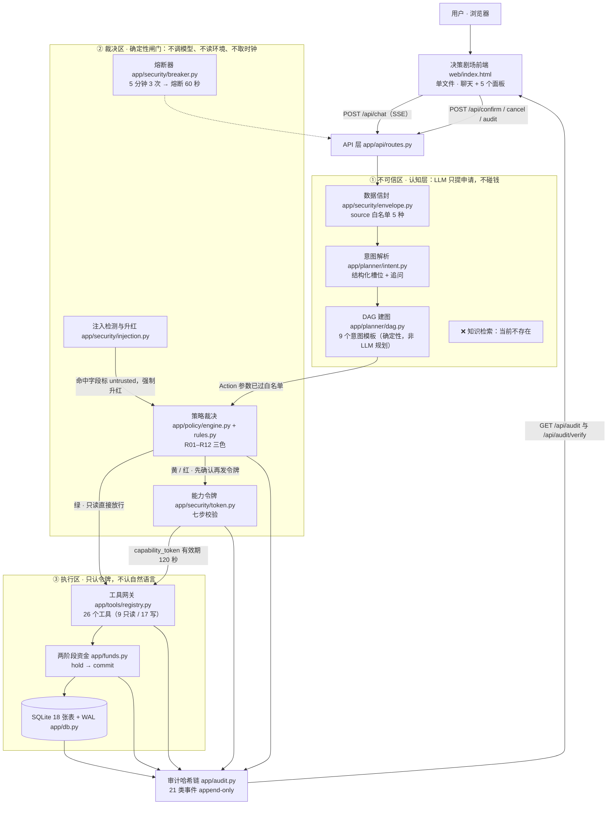

# 改造实施基线

> **用途**：本文件是「阶段 1 仓库审查」的交付物，也是后续所有改造（知识层、主动财务管理）的**事实底账**。
> **取数口径**：全部数字与代码引用均为 **2026-10-23 在本仓库实测**，命令见各处标注；不以 README 历史文字为准。
> **状态说明（2026-10-23 追加）**：本文件是**改造前基线快照**，其中 904 passed / 26 工具 / 18 表 / 21 类审计事件均属改造前事实，保留作对照证据；改造后终值为 1131 passed / 33 工具 / 22 表 / 29 类审计事件（见 `docs/benchmark/final_acceptance_report.md`）。
> **仓库**：`banking-agent`，分支 `main`，审查时 HEAD = `011c564 merge: 忽略 data/api_token`，工作区干净。

---

## 〇、一句话结论

本项目**已经是一个成熟且安全的银行 AI 智能体竞赛原型**：26 个受管工具、12 条确定性权限规则、9 个意图模板、18 张 SQLite 表、21 类哈希链审计事件、904 条全绿单测（4 skipped）、43 条红队用例，赛题 6 大场景全部有真实后端实现。

但它**不是知识驱动的**：全链路里**没有任何一处检索业务知识**——业务约束只写在两处硬编码里（`app/planner/intent.py` 的 `SYSTEM_PROMPT` 提示词、`app/policy/rules.py` 的规则表）。同时它**没有主动服务能力**：订阅续费只在结果字段里显示日期，没有任何提醒/监测/主动推送。

因此本次改造的两条主线非常明确：

1. **补一个真正参与决策的银行领域知识层**（术语规范化 → 意图规则 → 工作流约束 → 权威来源），并用对照实验证明它改变了系统行为；
2. **补一条可运行、可测试的主动财务管理闭环**（储蓄目标 → 计划 → 监测 → 提醒 → 重算），且不触碰原有授权边界。

---

## 一、当前架构（实测绘制，修正自 `docs/架构图.mmd`）



**与仓库内 `docs/架构图.mmd` 的差异见 §八（文档与代码不一致之处）。**

---

## 二、12 个模块的真实调用链

| # | 模块 | 路径 / 关键函数 | 输入 → 输出 | 调用者 | 副作用 |
|---|---|---|---|---|---|
| 1 | 用户消息入口 | `app/api/routes.py:POST /api/chat` | `ChatRequest{session_id?, text≤500}` → `StreamingResponse` | 前端 | 建会话、写 `session.start` 审计 |
| 2 | 大模型调用与上下文管理 | `app/planner/intent.py:parse()` / `build_messages()`；`app/llm.py`（OpenAI 兼容 + 多厂商降级） | `text + 最近 6 轮历史` → `IntentResult` | `routes._parse` | 一次模型调用；失败重试 1 次；再失败降级 `unknown` |
| 3 | 意图识别与槽位提取 | `app/planner/intent.py:_first_call_args` / `_from_args` / `_slots` / `_missing` / `_apply_branches`；schema 在 `app/planner/intent_schema.py` | 模型结构化输出 → `intent / slots / missing / confidence / question` | `parse()` | 无（**纯解析，一个工具都不执行**） |
| 4 | DAG 规划与工作流执行 | `app/planner/dag.py:build_or_single / build / validate / topo`；执行在 `app/planner/executor.py:run` | `{intent, slots}` → `Dag` → 逐节点执行 | `routes._start_run` | 写 `dag_runs` / `dag_nodes` / 审计 |
| 5 | 权限策略 | `app/policy/engine.py:decide()`（纯函数）+ `app/policy/rules.py:RULES`（12 条） | `Action + PolicyContext` → `Decision(level, rule_id, reason_code, required_factors)` | `executor.ask_policy` | 写 `policy.decided` 审计 |
| 6 | 用户确认与强验证 | `app/planner/executor.py:_guard`；`app/planner/state.py:new_confirmation / wait_for_answer / factors_ok` | `Decision` → 确认帧 → 用户 `approve + factor` | 前端 `/api/confirm` | 写 `confirm.requested / approved / rejected`；超时 120 s 作废并释放预授权 |
| 7 | 能力令牌验证 | `app/security/token.py:issue_audited / verify`（7 步：结构→签名→过期→nonce→tool→params_hash→account/amount） | `Action` → `body.sig`；`verify` 返回 `TokenPayload` | `executor.issue_token` → `tools` | 写 `token.issued / token.rejected`；nonce 一次性（重放即拒） |
| 8 | 业务工具 | `app/tools/registry.py:execute` → `app/tools/tool_specs.py`（26 个 `ToolSpec`）→ `app/tools/{transfers,invest,subs,cards,bill,queries,products,scheduled,split}.py` | 工具名 + 参数 + 令牌 → `ToolResult` | `executor.execute_node` | 写库 + `tool.executed` 审计 |
| 9 | 数据库与模拟账单 | `app/db.py`（`SCHEMA_SQL` / `connect` / `tx` / `ensure_columns`）、`app/funds.py`（两阶段资金）、`scripts/seed.py` | SQL | 全部层 | 18 张表，WAL |
| 10 | 审计与错误处理 | `app/audit.py:append`（21 类闭集 + 哈希链 + 禁改触发器）、`app/security/breaker.py`、`app/clock.py`（`BankError` 分类） | 事件 + 载荷 → 追加 | 全部层 | `audit_log` 只增不改 |
| 11 | 前端路由与页面 | `web/index.html`（**1173 行单文件**，无路由框架）；面板：意图 / 计划 / 权限灯 / 多因子验证 / 审计链 | SSE 事件 → DOM | 浏览器 | 仅本地状态 |
| 12 | 现有后台调度 | `app/planner/ticker.py:tick_interval_ms / run_due_once / tick_forever / start`；`app/tools/scheduled.py` | 到期预约 → 执行 | `app/main.py` 生命周期 + `POST /api/scheduled/run` | 执行预约转账、写审计 |

---

## 三、任务书 1.2 的七个重点问题（有据回答）

### Q1. 哪些判断由大模型完成？

只有**三类语义判断**：

1. **意图归类 + 槽位抽取**（`app/planner/intent.py`，一次 `emit_intent` 工具调用，temperature 0.0）；
2. **注入语句的语义判定**（`app/security/injection.py:classify_with_model` —— L2 模型分类器，**代码存在但生产未启用**，走的是 L1 关键词正则）；
3. **给用户看的话术**（模型自由文本进回复，但**不进账务结论**）。

### Q2. 哪些约束由代码强制执行？

**几乎全部硬约束**，全部是确定性代码：

- 权限颜色：`app/policy/rules.py` 12 条规则表 + `engine.decide()` 短路求值（纯函数，不调模型、不读环境、不取时钟 → 可重放）；
- 令牌七步校验：`app/security/token.py:verify`；
- 金额单位与解析：`app/money.py`（全程 int 分）；
- DAG 结构合法性：`app/planner/dag.py:validate`（ID 重复 / 依赖悬空 / 工具在册 / 无环）；
- 资金两阶段提交：`app/funds.py`（hold → commit，幂等键、日累计原子核）；
- 审计哈希链与禁改触发器：`app/audit.py`；
- 熔断：`app/security/breaker.py`。

**结论：模型输出永远只是「待审查的操作申请」，不是执行授权。** 这条不变量本次改造必须保持。

### Q3. 当前系统在哪里检索知识？

**无处可检索。** 全仓 grep `knowledge` / `ontology` / `terms` / `RAG` / `检索` / `知识` 无任何实现；仓库内**不存在 `knowledge/` 目录**。业务约束目前只存在于两处硬编码：

| 硬编码位置 | 性质 | 缺点 |
|---|---|---|
| `app/planner/intent.py:SYSTEM_PROMPT`（7 条规则，逐字照抄 `docs/07` 7.1，`tests/test_planner.py:161` 断言逐字一致） | 自然语言提示 | 不可版本化、不可追溯来源、不可按场景裁剪、无法回答「依据哪条法规」 |
| `app/policy/rules.py:RULES`（12 条硬编码阈值与话术） | 确定性策略 | 阈值无来源标注（如 `DAILY_LIMIT_FEN = 100_000` 不知是赛题设定还是法规） |

### Q4. 业务工具在哪里被真正调用？

唯一路径：`executor.execute_node()` → `tools.execute(node.tool, params, token=token, ctx=ctx)` → `tool_specs` 的 handler → SQLite。
**LLM 不能直接调工具**——`intent.parse()` 的 docstring 明写「解析器只出槽位，一个工具都不执行」。

### Q5. 哪些功能只是页面展示？

前端只有 5 个面板（意图 / 计划 / 权限灯 / 多因子验证 / 审计链），**全部是后端 SSE 事件的镜像，没有独立的前端业务逻辑，也没有「前端有、后端无」的功能**。
反向的空缺是：前端**没有**任何主动提醒 / 储蓄目标 / 预算面板——因为后端也没有。

### Q6. 哪些模块最适合接入新知识层？

| 优先级 | 接入点 | 位置 | 接入形态 |
|---|---|---|---|
| ★★★ | 意图解析出口 | `app/planner/intent.py:_from_args` 之后、`_apply_branches` 之前 | 用知识层的 `intent_rules.yaml` **确定性补齐缺失参数、判定歧义、判定禁止操作** → 直接改变是否追问、是否放行 |
| ★★★ | 建图前 | `app/api/routes.py:_start_run` → `planner_dag.build_or_single` 之前 | 用 `workflows.yaml` 的依赖约束校验/纠正 DAG（如「赎回理财 → 到账 → 转账」） |
| ★★ | 模型上下文 | `app/planner/intent.py:build_messages`（`messages[0]` 必须保持 `SYSTEM_PROMPT` 不变，可在 index 1 追加知识块） | 让模型看到相关业务规则与权威依据，从而能**引用来源**回答 |
| ★★ | 术语规范化 | `intent.parse()` 调模型前 | 口语 → 标准术语的确定性映射，减少模型自由发挥 |
| ★ | 策略层 | `app/policy/rules.py` | **只允许收窄，永不放松**——本次改造原则上不动策略层的判定逻辑 |

### Q7. 哪些现有安全约束必须保持不变？

1. `SYSTEM_PROMPT` 逐字不变（`tests/test_planner.py:161` 钉死）；
2. `build_messages` 的 `messages[0]["content"] == SYSTEM_PROMPT`、`messages[-1]` 是 `<DATA>` 信封用户消息（`tests/test_planner.py:265`）；
3. `decide()` 是纯函数、不调模型、不读环境、不取时钟；
4. 令牌七步校验顺序不可换，第 4 步消耗 nonce；
5. 写工具「没有令牌就是硬失败」；
6. 参数指纹 `params_hash` 与实际执行参数必须一致（换收款人 = 换一笔）；
7. 审计事件类型是闭集 `EVENT_TYPES`，只增不改；审计载荷**不写用户原文与密钥**；
8. 熔断只计安全边界拒绝（`is_security_denial`），不计用户拒绝与超时；
9. 数据信封 `ALLOWED_SOURCES` 白名单；
10. `app/` 零代码执行面（`tests/test_no_exec_surface.py` + `scripts/prove_no_exec_surface.py` 静态证明）。

---

## 四、六大赛��� vs 真实实现（实测）

| 赛题场景 | 对应 intent | 对应工具 | 真实可用 | 证据 | 缺口（一句话） |
|---|---|---|---|---|---|
| 1 智能转账 | `transfer` / `schedule_transfer` | `resolve_payee`→`query_balance`→`transfer`；`schedule_transfer`；`split_transfer`；`reverse_transfer` | ✅ 可写 | `app/planner/dag.py:INTENT_TEMPLATES`；`tests/test_e2e_transfer.py`；`scripts/e2e.py` | 无跨场景复合（如赎回后转账） |
| 2 账单分析 | `bill_analysis` | `analyze_bill` | ✅ 只读 | `app/tools/bill.py`（分类汇总 + Top 商户 + 3 类异常：拆单 / 凌晨境外 / 订阅涨价） | 无预算模型、无储蓄目标、无主动监测 |
| 3 理财操作 | `invest`（buy/redeem/query） | `list_products` / `estimate_risk` / `buy_fund` / `redeem_fund` | ✅ 可写（R10 人脸+动态口令） | `app/tools/invest.py`；`tests/test_invest*.py` | 缺持仓与收益报表；赎回**到账时间**无规则依据（见阶段 2 待核验项） |
| 4 卡片管理 | `card_manage` | `list_cards` / `apply_virtual_card` / `set_card_limit` / `freeze_card` / `unfreeze_card` / `report_card_loss` / `close_card` / `change_card_pin` | ✅ 可写 | `app/tools/cards.py`；`tests/test_card*.py` | — |
| 5 订阅代扣 | `subscription` | `list_subs` / `cancel_subscription` | ✅ 可写 | `app/tools/subs.py`；`tests/test_subscription_cancel.py` | **续费提醒只在字段里显示日期，无主动提醒/推送** |
| 6 跨场景联动 | `birthday_plan` | `resolve_payee`→`query_balance`→`reserve_funds`→`pay_merchant` | ✅ 可写（4 节点） | `tests/test_birthday_intent.py`；`scripts/e2e.py` 13 步 | **只有这一条固定模板，没有通用的多场景 DAG 规划** |

**实测数字（2026-10-23）**：

```
工具数        26   （python3.12 -c "from app.tools.registry import TOOLS; print(len(TOOLS))"）
策略规则数    12   （from app.policy.rules import RULES）
意图模板数     9   （from app.planner.dag import INTENT_TEMPLATES as T）
审计事件类型   21   （from app.audit import EVENT_TYPES as E）
数据库表数     18   （sqlite3 data/bank.db "select count(*) from sqlite_master where type='table' and name not like 'sqlite_%'"）
```

---

## 五、现有安全边界（不可动的清单）

| 边界 | 实现 | 强度说明 |
|---|---|---|
| 三色权限 | `app/policy/rules.py` R01–R12 | 纯函数、可重放；R11 默认拒绝兜底；R12 其他账户置顶（先于 R01） |
| 能力令牌 | `app/security/token.py` | 7 步；参数指纹 + 账户 + 金额三重一致性；nonce 一次性；TTL 120 s |
| 用户确认 / 强验证 | `app/planner/executor.py:_guard` + `app/planner/state.py` | 黄灯要确认；红灯按 `required_factors` 要 face/sms/otp（**本地 mock，未接真实认证服务**） |
| 提示注入防御 | `app/security/injection.py`（L1 正则 + 等级下限）+ `app/security/envelope.py`（数据信封） | 命中只标记不拒绝；R04 只在**金额字段**被污染时升红（已知限制，见 `docs/安全自评报告.md` R-05） |
| 操作审计 | `app/audit.py` | 21 类闭集 + 哈希链 + 禁 UPDATE/DELETE 触发器；`/api/audit/verify` 可验链 |
| 异常熔断 | `app/security/breaker.py` | 5 分钟窗口 3 次安全边界拒绝 → 熔断 60 秒，半开试探 |
| 沙箱隔离 | `app/` **零代码执行面** | 替代设计（非容器沙箱）：`eval/exec/compile/subprocess/os.system/pickle/marshal/ctypes` 全部 0 命中；基线快照，后续口径见 `docs/security_sandbox.md` |
| 幂等 | `app/funds.py:idempotency_key_for` + `token_nonces` 主键 | 重复执行不重复扣款；令牌重放即拒 |
| 回退 | `reverse_transfer` | 7 天窗口、只冲本人出账、金额取自原交易而非模型报数、冲正不可再冲正 |

---

## 六、测试基线（2026-10-23 实测，非 README 引用）

### 6.1 单元与集成测试

```
$ .venv/bin/python -m pytest -q tests/
904 passed, 4 skipped, 1 warning in 12.62s
```

| 项 | 值 |
|---|---|
| 测试总数 | **908**（904 passed + 4 skipped） |
| 通过 | 904 |
| 失败 | **0** |
| 跳过 | 4（浏览器冒烟等需环境变量，默认跳过属设计） |
| 执行命令 | `.venv/bin/python -m pytest -q tests/`（等价 `make test`） |
| 环境要求 | Python 3.12.13；`.venv` 已装 pytest 9.1.1；无需网络与模型密钥即可跑完全部单测 |
| 原有失败 | 无 |
| 警告 | 1 条 `StarletteDeprecationWarning`（fastapi TestClient 与 httpx2），与本次改造无关 |
| 安全测试范围 | `tests/test_injection_*.py`、`test_token.py`、`test_capability_secret.py`、`test_policy.py`、`test_breaker*.py`、`test_refusal_guard.py`、`test_no_exec_surface.py`、`test_confirm*.py`、`test_envelope.py`、`test_funds*.py`、`test_payee_discriminator.py`、`test_phone_payee.py` |
| 浏览器 / 接口覆盖 | `tests/test_browser_smoke.py`（默认 skip）+ `scripts/browser_smoke.py`（真 Chromium）；接口层由 `tests/test_api.py` 以 `TestClient` 覆盖 |
| 红队 | `make redteam` → `scripts/redteam.py`，43 条用例（A 诱导转账 10 / B 越权 10 / C 注入 10 / D 信息套取 8 / E 异常 5），夹具在 `tests/redteam/cases.yaml` |

### 6.2 模型连通性（实测可用）

```
$ python3.12 scripts/provider_check.py
连通性 PASS（HTTP 200，3511 ms）/ 工具调用 PASS（tool_calls 1 个，finish_reason=tool_calls）
/ tool_choice:auto PASS / SSE 流式 PASS（24 条 data 行）
结论：可用（4/4 项通过）
```
端点 `https://api.minimaxi.com/v1/chat/completions`，模型 `MiniMax-M3.1-Flash-Preview`，`LLM_TEMPERATURE=0.0`，`MOCK_MODE=false`。
→ **阶段 4 的 A/B 对照实验可以用真实模型跑，不必用脚本桩。**

### 6.3 已知的环境限制

- `web_fetch` 工具在本环境不可用（`multiple usable web providers are registered`），外部资料抓取改用 `curl -A "<浏览器 UA>"` 或 ego 浏览器；
- `revolut.com` 对无浏览器 UA 的请求返回 403（Akamai），Revolut 官方页面必须走 ego 浏览器读取；
- 政府站点（miit / nfra）用带 UA 的 `curl` 可正常访问（200）。

---

## 七、AIR 对标后的能力缺口（详见 `docs/benchmark/air_vs_banking_agent.md`）

| 维度 | AIR 公开能力（证据状态见对标文档） | 本项目现状 | 缺口 |
|---|---|---|---|
| 领域知识 | 公开材料显示 AIR 能回答「上月买菜花了多少」等业务问题 | **无知识层**，约束全在硬编码提示词与规则表 | **P0 最大缺口**：无术语、无本体、无来源、无引用 |
| 术语消歧 | AIR 处理自然语言金融表达 | 靠模型自由发挥 + 少量关键词兜底（`RELATION_PAYEES` 24 条等） | 缺确定性术语表 |
| 业务规则可追溯 | 公开材料未披露 AIR 的规则来源 | 阈值 `100_000` 分**无来源标注**，不知是赛题设定还是法规 | 缺 `rule_level` 分级（法条/银行公开规则/竞赛自设） |
| 主动服务 | 第三方分析称 AIR 以「reactive」为主，不主动推送 | **完全没有**主动提醒 / 监测 | **P1 主线**：储蓄目标闭环 |
| 跨场景 | AIR 覆盖消费 + 投资 + 订阅 + 卡片 + 旅行 | 只有 1 条固定 4 节点模板（生日订花） | 缺通用多场景 DAG 规划与依赖校验 |
| 写操作确认 | 第三方称 AIR 每笔金融交易绑定生物识别 | 本项目黄灯确认 / 红灯三重因子（本地 mock） | 形态已对标，真实认证未接（如实标注） |
| 隐私 | AIR 公开宣称 zero-data retention | 本项目不把完整流水传给模型（工具返回结果按需取），审计不写原文 | 已对标，缺**知识层文本**的同等处理（新增约束） |
| 解释与引用 | AIR 能给出「为什么」 | 有 `engine.explain()` 三行解释，但**无来源引用** | 缺「依据哪条规则/哪个来源」 |

---

## 八、文档与代码不一致之处（实测发现的 6 处）

| # | 位置 | 文档写的 | 代码实际 | 处置 |
|---|---|---|---|---|
| 1 | `docs/架构图.mmd` | 「6 个意图模板」 | **9** | 改图 |
| 2 | `docs/架构图.mmd` | 「工具网关 14 个工具」 | **26** | 改图 |
| 3 | `docs/架构图.mmd` | 「SQLite 17 张表」 | **18** | 改图 |
| 4 | `docs/架构图.mmd` | 「审计哈希链 16 类事件」 | **21** | 改图 |
| 5 | `docs/架构图.mmd` | 「数据信封 → 意图解析」链路，未画知识层 | 无知识层（属事实，但图里应显式标注缺口） | 加 ❌ 节点 |
| 6 | `docs/提交物对照表.md` §四 | 「689 条单测全绿（2026-10-22 实测）」 | 本次实测 **904 passed / 4 skipped** | 数字台账已是 904，§四正文遗留旧数字，改 |
| 附 | `docs/提交物对照表.md` §三 3.3 | 「多轮上下文继承」记为缺失（R-11） | `app/planner/clarify.py` 有 `Pending`/`remember`/`augment`，可做**收款人歧义续答**（`augment_clarification` 在 `routes._parse` 调用） | 属**局部**上下文续答，非通用多轮继承；口径要说准 |

> 另：`app/db.py` 内 `CREATE TABLE` 语句出现 19 次而实际建出 18 张表（差 1 为 `_ensure_columns` 辅助语句，非独立表）——引用表数时以实际库为准。

---

## 九、新增知识层与主动财务管理的接入建议

### 9.1 知识层接入建议（阶段 3 执行依据）

**新增 `app/knowledge/` 包 + 仓库根 `knowledge/*.yaml`**，四层职责：

| 文件 | 内容 | 消费者 |
|---|---|---|
| `knowledge/terms.yaml` | 30–50 术语（标准名 / 同义词口语 / 定义 / 关联概念 / 适用场景 / 来源 / 歧义限制） | `knowledge.normalize()`（确定性） |
| `knowledge/ontology.yaml` | 15–25 实体与关系（用户—账户—收款人—转账指令—交易—理财产品—申赎—代扣协议—储蓄目标—预算—风险信号—确认—授权—审计） | `knowledge.retrieve()` 元数据过滤 |
| `knowledge/intent_rules.yaml` | 每意图：必需 / 可选参数、歧义处理、追问条件、前置条件、可调工具、**不允许的操作**、来源 | `intent.py` 出口（决定追问与否） |
| `knowledge/workflows.yaml` | 流程前置条件 / 节点依赖 / 状态转换 / 失败处理 / 必要确认 / 关联规则 | `dag.py` 建图后校验（依赖顺序） |
| `knowledge/sources.yaml` | 来源登记（阶段 2 产出），含 `rule_level: law \| bank_public \| contest_simulation` | 引用与合规标注 |

**接线点（按侵入性从低到高）**：

1. `app/planner/intent.py:parse()` —— 在调模型**前**做术语规范化；在 `_from_args` **后**用 `intent_rules.yaml` 补缺失槽位、判禁止操作（这一步是**确定性**的，因此改进可被对照实验量化）。
2. `app/planner/intent.py:build_messages()` —— 在 `messages[0]`（`SYSTEM_PROMPT`）**之后**追加一条知识块消息（不改 `messages[0]`，不改 `messages[-1]` 的 `<DATA>` 用户信封，满足 `tests/test_planner.py:161,265`）。知识块中的外部文本必须经 `envelope.escape()` 处理，防止标签注入。
3. `app/planner/dag.py:build_or_single()` —— 建图后用 `workflows.yaml` 校验依赖顺序；不合法则**降级为追问/拒绝**，不静默改图。
4. `app/policy/rules.py` —— **本次不动判定逻辑**。知识层只允许影响「问不问 / 填不填槽位」，不允许影响「放不放行」。这样「未授权写操作执行次数 = 0」天然保持。

**安全边界（新增，必须写进实现）**：

- 知识层检索到的文本是**数据**，不是指令；任何知识条目都**不得**改变权限等级、跳过确认或授权；
- 知识条目冲突 / 来源过期 / 检索失败 → **降级**（按现有规则继续，不放行额外权限）并落审计告警；
- 知识 ID 与来源 ID 必须随裁决落审计（新增审计事件类型需扩 `app/audit.py:EVENT_TYPES` 闭集——注意它是闭集，扩展要同步改测试）。

### 9.2 主动财务管理接入建议（阶段 5 执行依据）

**新增数据实体**（加进 `app/db.py:SCHEMA_SQL` + `ensure_columns`，**不另起重复表**）：`savings_goals`、`monitor_rules`、`proactive_alerts`、`monitor_runs`。

**新增工具**（须同时登记进 `app/tools/tool_specs.py` **和** `app/policy/rules.py` 的工具分类，否则 R03 直接红拒）：
`list_savings_goals`（只读）、`compute_savings_plan`（只读）、`create_savings_goal`（黄灯确认）、`update_savings_goal`（黄灯确认）、`list_proactive_alerts`（只读）、`resolve_proactive_alert`（黄灯确认）。
**不新增任何动钱工具**——主动财务管理只做分析 / 计划 / 提醒。

**确定性计算**：全部金额走 `int` 分（与 `app/money.py` 一致）或 `Decimal`；模型只负责**解释与组织建议**，不负责算金额。

**触发方式**：先做**手动可重复触发**的监测任务（对齐现有 `POST /api/scheduled/run` → `ticker.run_due_once` 的既有模式），再考虑接入 `ticker.tick_forever` 的后台节拍。**不得把手动按钮描述成全天候服务。**

---

## 十、已知工程风险

| # | 风险 | 影响 | 缓解 |
|---|---|---|---|
| R1 | `SYSTEM_PROMPT` 被测试逐字钉死（`tests/test_planner.py:161`） | 改提示词即破坏测试 | 知识以**独立消息**注入，不动 `SYSTEM_PROMPT` 本身 |
| R2 | `app/audit.py:EVENT_TYPES` 是**闭集** | 新增知识/监测事件会被拒 | 扩展时同步改 `EVENT_TYPES` 与相关测试，属**扩展**非削弱 |
| R3 | `app/policy/rules.py:KNOWN_TOOLS` 是白名单 | 新工具未登记 → R03 红拒 | 新工具同批登记进 `tool_specs.py` 与 `rules.py` 分类 |
| R4 | 真实模型有随机性 | A/B 对照实验结果可能不稳 | 固定 temperature 0.0、固定模型与端点、固定样本集；开发集与留出集分离；记录模型版本与时间 |
| R5 | 注入「命中但不升色」是已知限制（R-05） | 知识层新增文本是新的注入面 | 知识文本经 `envelope.escape()`；知识不得影响权限；新增攻击用例进阶段 6 |
| R6 | 多因子是本地 mock | 不可声称已接真实生物识别 | 文档如实标注 |
| R7 | 单用户单账户、无登录体系 | 非真实银行形态 | 保持「比赛原型 / 虚构数据」口径 |
| R8 | `data/api_token` 与 `data/token_secret` 是运行期文件 | 误提交会泄密 | 已在 `.gitignore`；本次改造不新增密钥文件 |
| R9 | 阶段 2 的银行公开流程多在 JS 渲染页，核验可能受限 | 知识层部分规则只能标「待核验」 | 知识条目允许 `status: unverified`，并让该状态**影响行为**（降级为追问而非放行） |
| R10 | 前端是单文件 1173 行 | 继续加面板会膨胀 | 扩展现有「决策剧场」右侧面板区，不新建页面系统 |

---

## 十一、本基线的自证命令

```bash
cd banking-agent
git status --short && git branch --show-current && git log -5 --oneline
git ls-files | wc -l
.venv/bin/python -m pytest -q tests/                      # 904 passed / 4 skipped
python3.12 scripts/provider_check.py                     # 4/4 PASS
python3.12 -c "from app.tools.registry import TOOLS; from app.policy.rules import RULES; from app.planner.dag import INTENT_TEMPLATES as T; from app.audit import EVENT_TYPES as E; print(len(TOOLS), len(RULES), len(T), len(E))"   # 26 12 9 21
sqlite3 data/bank.db "select count(*) from sqlite_master where type='table' and name not like 'sqlite_%'"   # 18
python3.12 scripts/prove_no_exec_surface.py              # 代码执行面 0
```

---

**基线快照（2026-10-23）**：HEAD `011c564` · 904 passed / 4 skipped / 0 failed · 26 工具 · 12 规则 · 9 模板 · 18 表 · 21 审计事件 · 模型 4/4 可用。